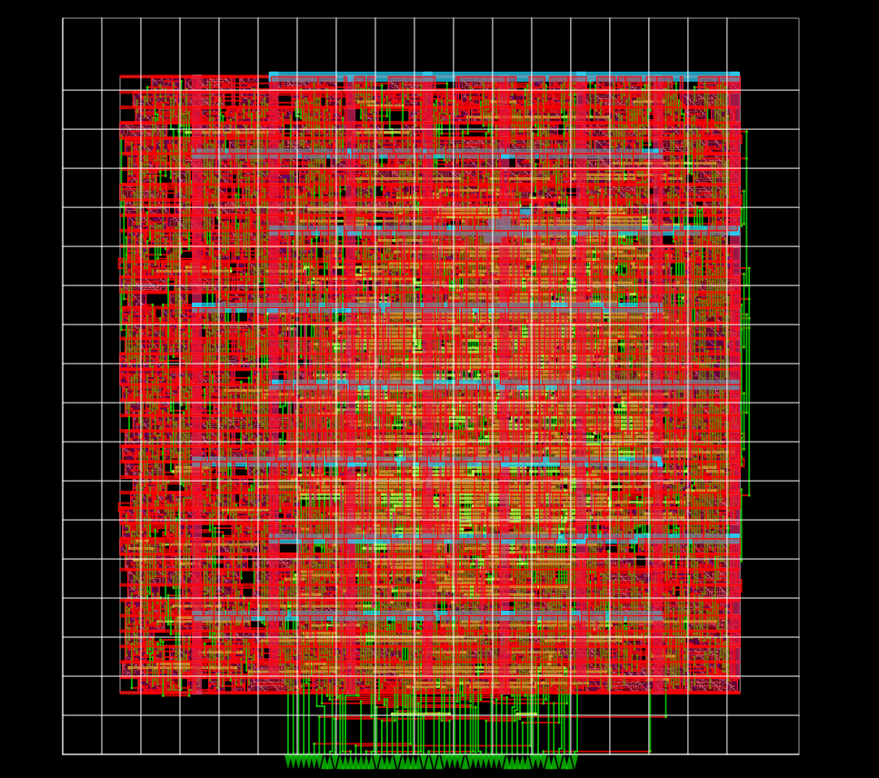
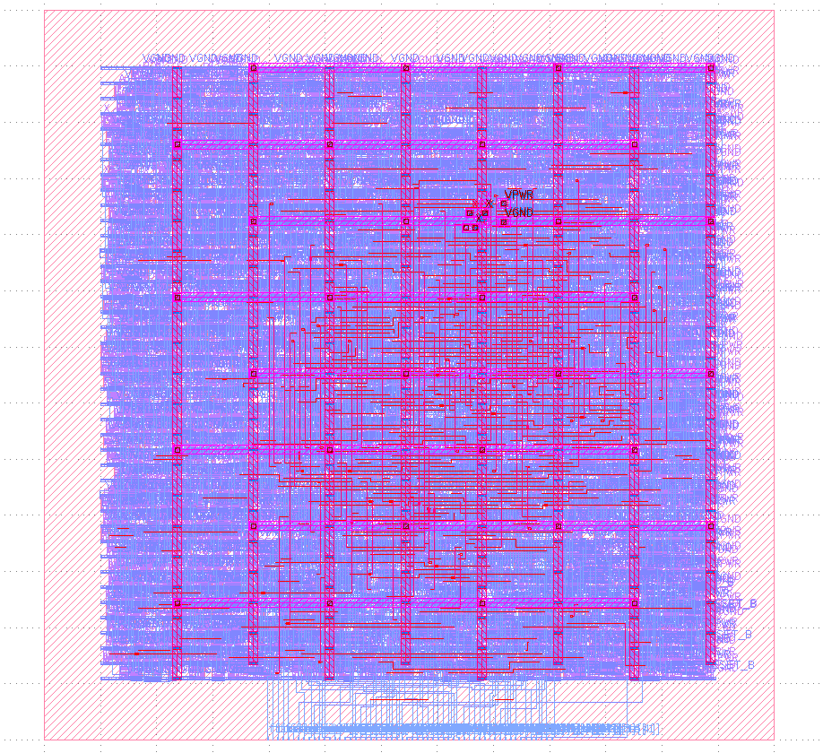
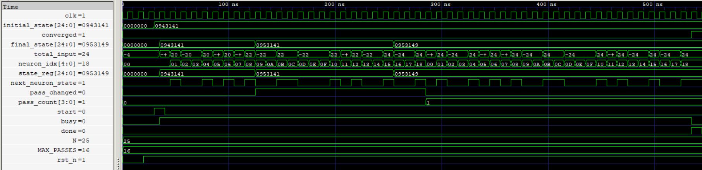
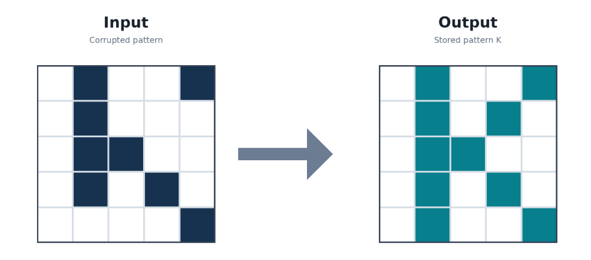
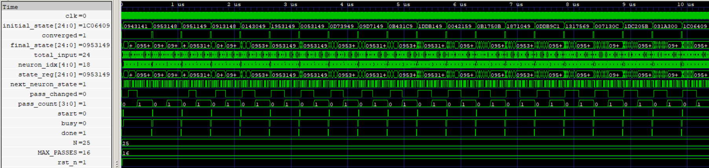

# Hopfield Network

A Hopfield network functions as an associative memory, recovering stored patterns from corrupted inputs by iteratively updating neuron states until the network reaches a stable configuration.

Unlike conventional memory systems, which retrieve data using an explicit address, associative memory recalls information from the content of an input pattern. When presented with a sufficiently similar pattern, the network can recover the stored configuration through interactions between its interconnected neurons.

## 🏗️ Physical Implementation
The Hopfield Network was taken for physical implementation to evaluate its area, timing, and power characteristics beyond synthesis. The design was taken through floorplanning, placement, clock tree synthesis, and global and detailed routing using OpenROAD and the Sky130HD standard-cell library, culminating in GDSII layout generation.

<table align="center">
  <tr>
    <td align="center" style="padding-right: 50px;">
       
         </b> Hopfield Network Post-Route Physical Layout (OpenROAD)
    </td>
    <td align="center" style="padding-left: 50px;">
       
         </b> Hopfield Network GDSII Layout (KLayout)
    </td>
  </tr>
</table>

## 🧠 Associative Recall

The network stores a 5 × 5 binary pattern and attempts to recover it from an initially corrupted state.

  

  
    
  A corrupted input pattern is recalled as the stored configuration through iterative neuron updates.

## 🔬 Physical Characterization

The Hopfield Network was taken through synthesis and physical implementation using the Sky130HD standard-cell library. The following table summarizes the estimated metrics at each stage.

> Sky 130HD

| Implementation Stage |    Cell Area | Cell Count | Critical Path | Estimated Fmax | Estimated Power |
| -------------------- | -----------  | ---------  | ------------  | -------------  | --------------  |
| Post-Synthesis       | 9,336.45 µm² |      1,213 |      20.02 ns |     ~49.95 MHz |          392 µW |
| Post-P&R             | 9,724.33 µm² |      1,334 |      20.00 ns |        ~50 MHz |          504 µW |

**Detailed reports and implementation artifacts:**

- 📊 [Post-Synthesis Metrics](metrics/)
- 🏗️ [Post-Place-and-Route Reports and GDSII](gds/)

## ⚙️ Implementation

- Hebbian Weight Matrix: A predefined symmetric weight matrix with zero diagonal entries.
- Bipolar Neurons: Binary `1` represents `+1`, while binary `0` represents `−1`.
- Sequential Updates: Neurons are updated individually according to their weighted inputs.
- Convergence Detection: The network stops when a complete pass produces no state changes.
- Bounded Execution: A configurable maximum pass count prevents indefinite operation.

## 🧪 Verification

The implementation has been tested through both RTL simulation and gate-level simulation.

| Verification          |             Result |
| --------------------- | -----------------: |
| RTL simulation        | 20/20 tests passed |
| Gate-level simulation | 20/20 tests passed |

  
    
  All 20 selected test inputs converged to the expected stored pattern.

## 📚 Documentation

* [Hopfield Network Fundamentals](Hopfield.md)
* [Hebbian Matrix Generator](Hebbian.py)
* [RTL Source Files](src)
* [Post-Synthesis Metrics](metrics)
* [Physical Implementation & GDSII](gds)

## 📜 License

- Source code and HDL files are licensed under the MIT License.
- Documentation, diagrams, images, and PDFs are licensed under the Creative Commons Attribution 4.0 International (CC BY 4.0) License.
