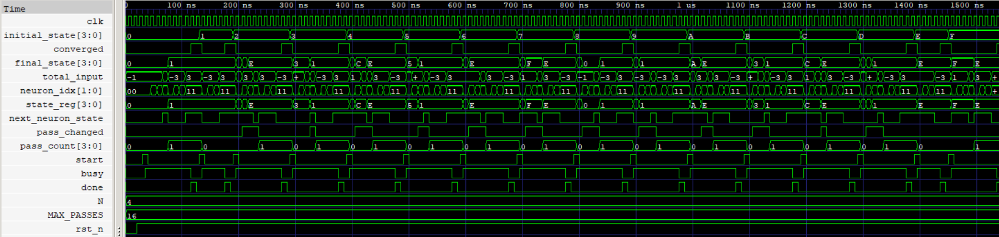

# Hopfield Network

A Hopfield network functions as an associative memory, recovering stored patterns from corrupted inputs by iteratively updating neuron states until the network reaches a stable configuration.

Unlike conventional memory systems, which retrieve data using an explicit address, associative memory recalls information from the content of an input pattern. When presented with a sufficiently similar pattern, the network can recover the stored configuration through interactions between its interconnected neurons.

## 🧠 Associative Recall

The network stores a 5 × 5 binary pattern and attempts to recover it from an initially corrupted state.

  

  
    
  A corrupted input pattern is recalled as the stored configuration through iterative neuron updates.

## 📚 Documentation

- [Hopfield Network Fundamentals](Hopfield.md) 
- [Hebbian Matrix Generator](Hebbian.py)
- [Source Files](src)

## ⚙️ Implementation

* **Hebbian Weight Matrix:** A predefined symmetric weight matrix with zero diagonal entries.
* **Bipolar Neurons:** Binary `1` represents `+1`, while binary `0` represents `−1`.
* **Sequential Updates:** Neurons are updated individually according to their weighted inputs.
* **Convergence Detection:** The network stops when a complete pass produces no state changes.
* **Bounded Execution:** A configurable maximum pass count prevents indefinite operation.

## 🧪 Verification

The implementation has been tested through both RTL simulation and gate-level simulation.

| Verification          |             Result |
| --------------------- | -----------------: |
| RTL simulation        | 20/20 tests passed |
| Gate-level simulation | 20/20 tests passed |

All 20 selected test inputs converged to the expected stored pattern. These results demonstrate successful recall for the tested cases, rather than guaranteeing recall for every possible input.

## 📜 License

* Source code and HDL files are licensed under the MIT License.
* Documentation, diagrams, images, and PDFs are licensed under the Creative Commons Attribution 4.0 International (CC BY 4.0) License.
