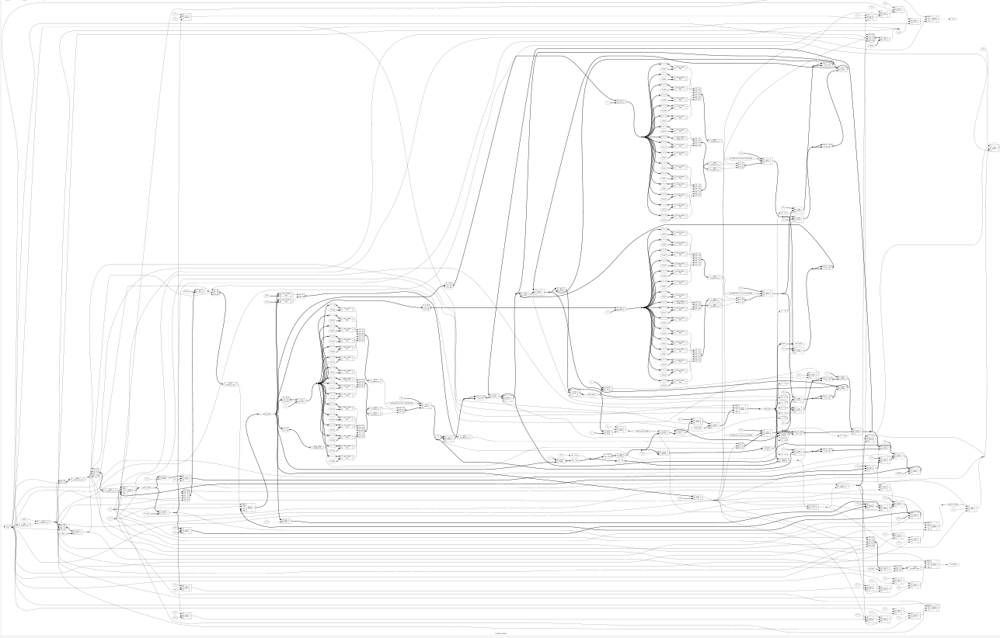

# Hopfield Network

A parameterized digital implementation of a Hopfield Network using SystemVerilog. The network acts as an associative memory, recovering stored patterns from initial states by iteratively updating neuron states according to their weighted inputs.

The design uses a predefined symmetric weight matrix with zero diagonal entries. Each neuron is updated asynchronously, one neuron per clock cycle, using bipolar state interpretation: binary `1` represents `+1`, while binary `0` represents `-1`. The network terminates when a complete pass produces no state changes or when the maximum pass limit is reached.

## Features

* Parameterized neuron count and maximum update passes
* Predefined symmetric weight matrix with zero diagonal
* Bipolar neuron representation using binary states
* Asynchronous neuron updates, one neuron per clock cycle
* Weighted-input calculation and threshold-based state updates
* Zero-input behavior that retains the current neuron state
* Automatic convergence detection
* Maximum-pass limit to prevent indefinite execution
* Completion and status signals: `busy`, `done`, and `converged`
* Testbench verification of all 16 initial states for the 4-neuron configuration

  
   
  Hopfield Network Synthesis

## Synthesis Results

**Technology:** Sky130 HD

**Synthesis Tool:** Yosys

| Metric              |            Value |
| ------------------- | ---------------: |
| Standard-Cell Count |           **87** |
| Sequential Cells    |           **14** |
| Chip Area           | **817.0336 µm²** |
| Memory Bits         |            **0** |

## Static Timing Analysis (OpenSTA)

**Clock Period:** 10 ns

| Metric                        |        Value |
| ----------------------------- | -----------: |
| Data Arrival Time             |  **2.52 ns** |
| Data Required Time            |  **9.87 ns** |
| Setup Slack                   | **+7.35 ns** |
| Estimated Critical Path Delay |  **2.52 ns** |
| Estimated Fmax                | **~377 MHz** |

## Power Analysis

| Metric              |      Value |
| ------------------- | ---------: |
| Sequential Power    | **107 µW** |
| Combinational Power | **143 µW** |
| Total Power         | **250 µW** |
